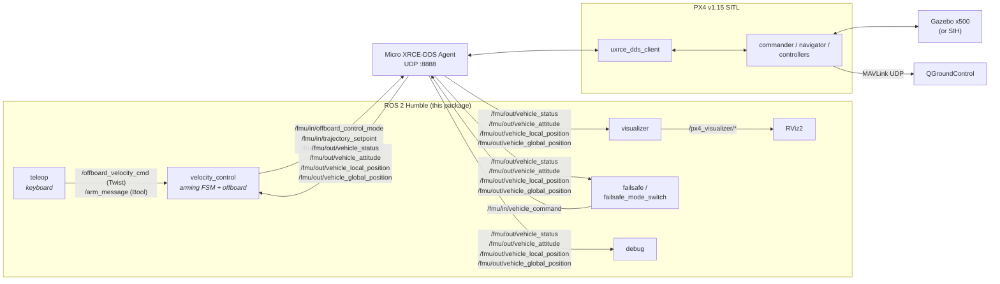
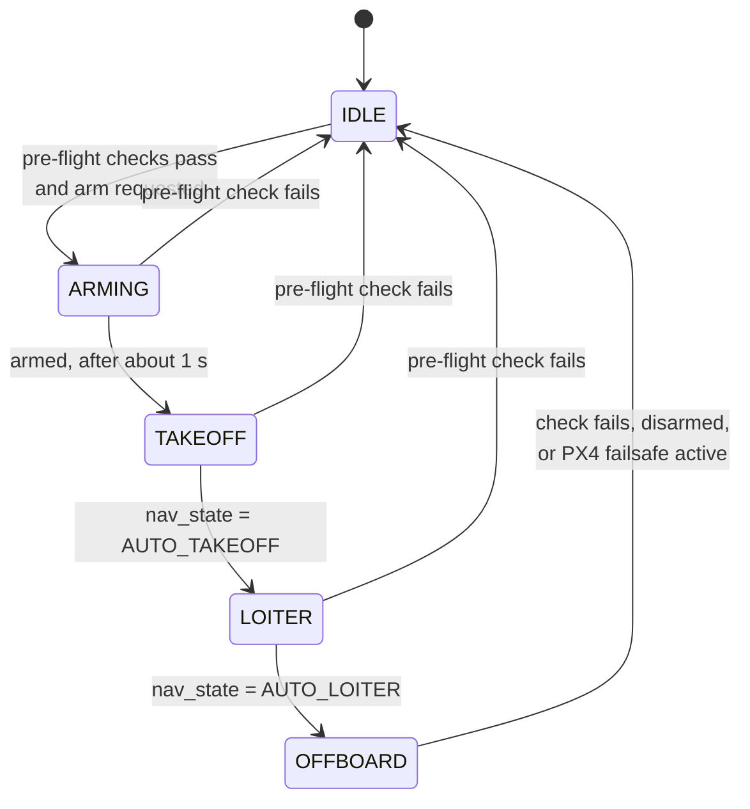

# PX4 + ROS 2 Offboard Control & GPS-Failsafe Testing

**Research internship project — IIIT Hyderabad (May – June 2025)**


A ROS 2 workspace for flying a simulated PX4 quadrotor in **offboard mode** from Python, and for
studying how the vehicle behaves when a **GPS-loss / Return-to-Launch (RTL) failsafe** is triggered.

It brings together, in one `colcon` package:

- **Autonomous arming → takeoff → offboard sequence** driven by a finite-state machine
- **Keyboard teleoperation** of body-frame velocity and yaw rate (Mode-2 RC layout)
- **Elliptical-orbit mode** — an experimental scripted trajectory triggered from the keyboard
- **Two GPS-failsafe experiment nodes** that put the vehicle into RTL/Hold and log the response
- **Connection diagnostics** for the ROS 2 ↔ PX4 (uXRCE-DDS) bridge
- **RViz2 visualisation** of vehicle pose, path, setpoint path and velocity vector
- **One-command bring-up** of the Micro XRCE-DDS Agent, PX4 SITL, QGroundControl and all nodes

---

## Contents

- [System architecture](#system-architecture)
- [Nodes](#nodes)
- [How offboard control works](#how-offboard-control-works)
- [GPS-failsafe experiments](#gps-failsafe-experiments)
- [Getting started](#getting-started)
- [Running](#running)
- [Keyboard controls](#keyboard-controls)
- [Verification](#verification)
- [Limitations & future work](#limitations--future-work)
- [Repository layout](#repository-layout)
- [Acknowledgements & attribution](#acknowledgements--attribution)
- [License](#license)

---

## System architecture



PX4 v1.15 talks to ROS 2 natively through its **uXRCE-DDS client**; the Micro XRCE-DDS Agent
turns that into ordinary ROS 2 topics under `/fmu/in/*` (commands to PX4) and `/fmu/out/*`
(telemetry from PX4). The message types come from [`px4_msgs`](https://github.com/PX4/px4_msgs),
included here as a submodule pinned to `release/1.15` so that the message definitions match the
firmware exactly.

## Nodes

| Executable | Source | Role |
|---|---|---|
| `velocity_control` | [velocity_control.py](src/drone_control/drone_control/velocity_control.py) | Arming/takeoff state machine; streams the offboard heartbeat and velocity setpoints at 50 Hz |
| `teleop` | [teleop.py](src/drone_control/drone_control/teleop.py) | Keyboard → `Twist` on `/offboard_velocity_cmd`, arm toggle on `/arm_message`, elliptical-orbit mode |
| `visualizer` | [visualizer.py](src/drone_control/drone_control/visualizer.py) | Converts PX4 NED telemetry to ENU and publishes pose, paths and a velocity arrow for RViz2 |
| `failsafe` | [failsafe.py](src/drone_control/drone_control/failsafe.py) | Scripted GPS-off → RTL → GPS-on test sequence |
| `failsafe_mode_switch` | [failsafe_mode_switch.py](src/drone_control/drone_control/failsafe_mode_switch.py) | Records home, switches PX4 to **AUTO.RTL** for 10 s, then to **AUTO.LOITER** (Hold) |
| `debug` | [debug.py](src/drone_control/drone_control/debug.py) | Decodes `vehicle_status` (arming, nav state, pre-flight checks, failsafe) and warns if the bridge goes quiet |
| `processes` | [processes.py](src/drone_control/drone_control/processes.py) | Opens terminal tabs for the XRCE agent, PX4 SITL and QGroundControl |

The launch file [startup.launch.py](src/drone_control/launch/startup.launch.py) starts
`processes` and `teleop` in their own `gnome-terminal` windows, plus `velocity_control`,
`visualizer` and RViz2 with the bundled [visualize.rviz](src/drone_control/resource/visualize.rviz).

## How offboard control works

### Arming state machine

`velocity_control` runs a 10 Hz state machine that takes the vehicle from the ground to offboard
flight as soon as `teleop` publishes `arm_message = true`:



| State | Command sent to PX4 (`/fmu/in/vehicle_command`) |
|---|---|
| `ARMING` | `VEHICLE_CMD_COMPONENT_ARM_DISARM` (param1 = 1) |
| `TAKEOFF` | arm + `VEHICLE_CMD_NAV_TAKEOFF` |
| `LOITER` | arm (wait for PX4 to finish takeoff and enter Hold) |
| `OFFBOARD` | `VEHICLE_CMD_DO_SET_MODE` (base mode 1, custom main mode 6 = OFFBOARD), repeated every cycle |

PX4 only accepts and keeps offboard mode while it receives an `OffboardControlMode` heartbeat
faster than 2 Hz. Once in `OFFBOARD`, a 50 Hz loop publishes that heartbeat with
`velocity = true`, plus a `TrajectorySetpoint` whose **position and acceleration are NaN** and
whose **yaw is NaN with a commanded `yawspeed`**. PX4 therefore tracks only the requested velocity
and yaw rate.

### Frames: body-relative commands → NED setpoints

Teleop commands are **relative to the drone's current heading** (forward/right/up and yaw
rate). `velocity_control` reads the current yaw from `/fmu/out/vehicle_attitude` and rotates the
horizontal velocity into PX4's world **NED** frame before publishing:

```
v_north = v_x·cos ψ − v_y·sin ψ
v_east  = v_x·sin ψ + v_y·cos ψ
v_down  = −v_up
```

The yaw extraction and the axis remapping inherited from the upstream example each introduce a
180° flip. The two cancel, so "forward" really is forward. This was confirmed in SITL: a forward
command at heading ≈ 0 rad produced ≈ +0.8 m/s north (see [Verification](#verification)).

`visualizer` performs the opposite conversion (NED → ENU) so that RViz2 shows the trajectory the
right way up.

## GPS-failsafe experiments

These two nodes were written to observe how PX4 handles a GPS-loss scenario and return-to-launch.

### `failsafe` — scripted RTL test

Five seconds after start it runs the sequence once:

1. stop publishing the synthetic `SensorGps` stream ("GPS off")
2. wait 3 s, then send `VEHICLE_CMD_NAV_RETURN_TO_LAUNCH`
3. wait 20 s, then resume the synthetic GPS stream ("GPS on")

It logs when PX4 reports `NAVIGATION_STATE_AUTO_RTL`.

> **Note:** `/fmu/in/sensor_gps` is **not** in PX4 v1.15's default
> [`dds_topics.yaml`](https://github.com/PX4/PX4-Autopilot/blob/release/1.15/src/modules/uxrce_dds_client/dds_topics.yaml),
> so the synthetic GPS stream does not reach the autopilot unless that topic is added to the bridge.
> In the default setup the RTL command alone drives the vehicle's behaviour.

### `failsafe_mode_switch` — RTL then Hold via mode switching

1. waits for `/fmu/out/vehicle_global_position` and records it as home
2. switches PX4 to **AUTO.RTL** with `DO_SET_MODE` (main mode 4 = AUTO, sub-mode 5 = RTL)
3. after 10 s (or on Ctrl+C) switches to **AUTO.LOITER** / Hold (sub-mode 3)

### Interaction with `velocity_control` — an important finding

While `velocity_control` is in its `OFFBOARD` state it re-sends the OFFBOARD mode command at
10 Hz. As a result, **an RTL triggered by another node is overridden within a fraction of a
second**. `velocity_control` only releases control when PX4 itself raises the `failsafe` flag (or
the vehicle disarms).

In SITL, running `failsafe_mode_switch` alongside `velocity_control` gave the sequence
`OFFBOARD → AUTO_RTL → OFFBOARD`. The two nodes' conflicting `OffboardControlMode` heartbeats also
made PX4 flip between OFFBOARD and a POSCTL failsafe.

**For clean failsafe experiments, run these nodes while the vehicle is in Hold, not under
`velocity_control`.** With that setup, `failsafe_mode_switch` produced the expected
`AUTO_RTL → (10 s) → AUTO_LOITER` sequence, and the vehicle flew back towards home.

## Getting started

### Prerequisites

| Component | Version used | Notes |
|---|---|---|
| Ubuntu | 22.04 | |
| ROS 2 | Humble | `ros-humble-desktop` (includes RViz2) |
| PX4-Autopilot | v1.15.x | built for SITL; `gz_x500` needs Gazebo (Garden/Harmonic) |
| Micro XRCE-DDS Agent | v2.4.x | must be on `PATH` as `MicroXRCEAgent` |
| QGroundControl | any recent | optional, for monitoring |
| Python packages | `numpy` | |

PX4 + ROS 2 setup guide: <https://docs.px4.io/v1.15/en/ros2/user_guide.html>

### Build

```bash
git clone --recurse-submodules https://github.com/Ashish480/px4-ros2-offboard-control.git
cd px4-ros2-offboard-control

source /opt/ros/humble/setup.bash
rosdep install --from-paths src --ignore-src -y   # optional: install missing deps
colcon build
source install/setup.bash
```

> Forgot `--recurse-submodules`? Run `git submodule update --init`.
> Building `px4_msgs` takes a couple of minutes the first time.

## Running

### Option A — everything with one command

```bash
source install/setup.bash
ros2 launch drone_control startup.launch.py
```

This opens `gnome-terminal` tabs for the XRCE agent, PX4 SITL (`make px4_sitl gz_x500`) and
QGroundControl, a separate window for the keyboard teleop, and starts `velocity_control`,
`visualizer` and RViz2.

Paths can be overridden with environment variables:

| Variable | Default |
|---|---|
| `PX4_DIR` | `~/PX4-Autopilot` |
| `QGC_APPIMAGE` | `~/qgc_temp/QGroundControl.AppImage` |

### Option B — step by step (one terminal each)

```bash
# 1. DDS bridge
MicroXRCEAgent udp4 -p 8888

# 2. PX4 SITL (Gazebo x500). Without Gazebo, PX4's built-in SIH works too:
#    make px4_sitl sihsim_quadx
cd ~/PX4-Autopilot && make px4_sitl gz_x500

# 3. Offboard controller + visualisation
ros2 run drone_control velocity_control
ros2 run drone_control visualizer
rviz2 -d install/drone_control/share/drone_control/visualize.rviz

# 4. Keyboard teleop (needs a real terminal)
ros2 run drone_control teleop
```

Failsafe experiments and diagnostics:

```bash
ros2 run drone_control debug                  # is the bridge alive? what state is PX4 in?
ros2 run drone_control failsafe_mode_switch   # RTL for 10 s, then Hold
ros2 run drone_control failsafe               # scripted RTL test
```

## Keyboard controls

Run `teleop` in its own terminal and keep that terminal focused.

| Key | Action |
|---|---|
| `Space` | Toggle arm request (starts the arm → takeoff → offboard sequence) |
| `W` / `S` | Climb / descend |
| `A` / `D` | Yaw left / right |
| `↑` / `↓` | Forward / backward |
| `←` / `→` | Left / right |
| `O` | Arm (if needed) and start the elliptical-orbit mode |
| `P` | Leave elliptical-orbit mode and zero all velocities |
| `Ctrl+C` | Quit; publishes a zero-velocity command on exit |

Commands are **incremental**: each press adds ±0.5 m/s (linear) or ±0.2 rad/s (yaw) to the
current command, which `velocity_control` keeps applying until it is changed. Press the opposite
key to slow down.

The orbit traces an ellipse with semi-axes 3.0 m × 1.5 m (velocity scale 0.5, updated every
0.1 s). See the limitations below.

## Verification

The package was rebuilt from a clean `git clone --recurse-submodules` and exercised in
**PX4 v1.15.4 SITL** (SIH quadrotor, headless) with the Micro XRCE-DDS Agent:

| Check | Result |
|---|---|
| `colcon build` from a fresh clone | ✅ `px4_msgs` + `drone_control` build cleanly |
| `velocity_control` arming FSM | ✅ `IDLE → ARMING → TAKEOFF → LOITER → OFFBOARD`; PX4 `nav_state` 4 → 17 → 4 → 14 |
| Body-frame forward command (1 m/s) | ✅ ≈ +0.7–0.8 m/s north at heading ≈ 0 rad, stops on zero command |
| `failsafe_mode_switch` from Hold | ✅ `AUTO_RTL` → vehicle returns home → `AUTO_LOITER` after 10 s |
| `failsafe` | ✅ sequence runs once; one RTL command sent; `AUTO_RTL` detected |
| `debug` | ✅ arming / nav states decoded correctly |
| `teleop` (pseudo-terminal) | ✅ key presses produce the expected `Twist`; zero `Twist` on exit |

## Limitations & future work

- **Elliptical orbit is experimental.** Keyboard reads block, so the orbit only advances while
  keys are being pressed (holding a key works). The vertical command alternates between 1.5 and
  0 m/s, so the vehicle climbs while orbiting. The heading angle is fed in as a yaw *rate*.
  Next step: move trajectory generation into a timer in `velocity_control`, in the world frame,
  with altitude feedback.
- **Realistic GPS loss.** A true GPS failure can be injected through the existing bridge with
  `VEHICLE_CMD_INJECT_FAILURE` (420), unit `FAILURE_UNIT_SENSOR_GPS` (4), type
  `FAILURE_TYPE_OFF` (1), after setting `SYS_FAILURE_EN = 1`. The equivalent PX4 shell command is
  `failure gps off`. This would exercise PX4's own failsafe logic instead of commanding RTL
  directly.
- **Blocking test sequence.** `failsafe` sleeps inside a timer callback, so status messages are
  only processed after the sequence finishes. A timer-driven step sequence would allow logging
  during the test.
- **Takeoff altitude.** `VEHICLE_CMD_NAV_TAKEOFF` is sent with `param7 = 5.0`, which PX4
  interprets as an AMSL altitude. In SITL the vehicle settled at PX4's default takeoff height
  (~2 m above home) instead of 5 m.

## Repository layout

```
.
├── README.md
├── LICENSE
└── src/
    ├── px4_msgs/                      # submodule → PX4/px4_msgs @ release/1.15
    └── drone_control/                 # ament_python package
        ├── drone_control/
        │   ├── velocity_control.py    # arming FSM + offboard velocity setpoints
        │   ├── teleop.py              # keyboard teleop + elliptical orbit
        │   ├── visualizer.py          # RViz2 markers / paths
        │   ├── failsafe.py            # scripted GPS-off → RTL test
        │   ├── failsafe_mode_switch.py# RTL → Hold via DO_SET_MODE
        │   ├── debug.py               # bridge / vehicle-status diagnostics
        │   └── processes.py           # opens agent / SITL / QGC terminals
        ├── launch/startup.launch.py
        ├── resource/visualize.rviz
        ├── package.xml
        └── setup.py
```

## Acknowledgements & attribution

This work builds on open-source examples, credited here precisely:

- **[ARK Electronics — ROS2_PX4_Offboard_Example](https://github.com/ARK-Electronics/ROS2_PX4_Offboard_Example)**
  (Braden Wagstaff).
  - `velocity_control.py` and `visualizer.py` are used **unmodified**.
  - `teleop.py`, `processes.py` and the launch file are adapted from it.
- **[Jaeyoung Lim — px4-offboard](https://github.com/Jaeyoung-Lim/px4-offboard)**: original author
  of the visualizer.
- **[PX4 Autopilot](https://px4.io/)** and **[px4_msgs](https://github.com/PX4/px4_msgs)**.

**Contributions of this project:**
- the elliptical-orbit mode in `teleop.py`
- the GPS-failsafe experiment nodes (`failsafe.py`, `failsafe_mode_switch.py`)
- the bridge diagnostics node (`debug.py`)
- the analysis of controller / failsafe interaction described above
- packaging everything as a single reproducible workspace pinned to PX4 v1.15

Carried out during a research internship at the
**International Institute of Information Technology, Hyderabad (IIIT Hyderabad)**.

## License

Released under the [BSD 3-Clause License](LICENSE), the same license as PX4. Files derived from
upstream projects keep their original copyright headers.

---

**Author:** [Ashish Shajan](https://github.com/Ashish480)
